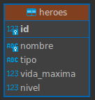

# Diagrama: flujo de la opcion "insertar heroe"

```
Usuario escribe nombre, tipo, vida y nivel
   |
   v
HeroeUI.registrar()          [View: solo Scanner y System.out]
   |  controller.registrar(nombre, tipo, vida, nivel)
   v
HeroeController.registrar()  [Controller: valida nombre, tipo, vida > 0, nivel >= 1]
   |  si falla -> Respuesta.error(mensaje) y vuelve a la View
   |  si pasa  -> dao.insertar(new Heroe(...))
   v
HeroeDAO.insertar()          [DAO: PreparedStatement INSERT ... VALUES (?, ?, ?, ?)]
   |  ConexionDB.obtener() lee config.txt y abre la Connection
   |  ps.executeUpdate()
   v
MySQL: rpg_grupal_db.heroes  [UNIQUE en nombre, CHECK en tipo, vida y nivel]
   |
   v  filas afectadas, o SQLException (1062 = nombre repetido -> DaoException)
Respuesta.ok("Heroe X guardado.") sube por DAO -> Controller -> View, que la imprime
```
